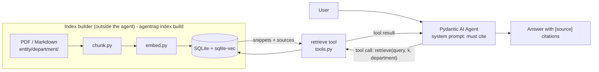

# agent-rag-pydantic-ai

[](https://github.com/wchklaus97/agent-rag-pydantic-ai/actions/workflows/tests.yml)

**Theme: agent-first RAG. Retrieval is a typed *tool* the agent decides to call, not a fixed step in a chain.**

A small, runnable demo with [Pydantic AI](https://ai.pydantic.dev/). The index lives outside the agent (SQLite + sqlite-vec). The agent has a `retrieve` tool (and a `list_sources` tool), must cite the sources the tool returns, and prints every tool call so you can watch the loop.

> The sample corpus is a **fictional** Hong Kong group, *Harbour Lane Group Limited* (HK head office + Shenzhen subsidiary), with bilingual 繁體/廣東話 + English documents under `entity/department/`. Policies are invented for teaching; nothing here is legal or HR advice.

## What you will learn

1. **Where "R" and "G" live in an agent:** R = the `retrieve` tool call, G = the LLM writing from tool results.
2. **Pydantic AI does not ingest, chunk or embed.** Those happen in the index builder before the agent runs.
3. **When tools beat chains:** the model can search several times, filter by department, skip retrieval for small talk, or ask what documents exist.
4. How to design a retrieval tool an LLM can use safely (empty-safe, clamped, cite-ready), and why its docstring is part of the prompt.
5. How to evaluate an agent (tool choice, citations, facts, language, refusals) and enforce a rule with an output validator.

## The part you can lift out

[`src/agentrag/tools.py`](src/agentrag/tools.py): the retrieve tool's contract (`Snippet`, `Searcher` protocol, `retrieve_snippets`, `list_sources`). It needs only `pydantic`; wrap it in any agent framework, back it with any search.



### Contrast: agent-first vs chain-first

| | This repo (Pydantic AI agent) | LangChain LCEL RAG chain | LlamaIndex QueryEngine |
|---|---|---|---|
| Who decides to retrieve? | **The model**, per question | You: retriever is a fixed step in the pipeline | You: the engine always retrieves then synthesises |
| Retrieval count | 0, 1 or many calls, each with its own query | Exactly once (unless you build a loop) | Once per query (sub-question engines add more) |
| Ingest / chunk / embed | **Not provided**, you build the index | Loaders + splitters + vector stores in the framework | Readers + node parsers + indices in the framework |
| Strength | Flexible, multi-step, easy to add other tools | Predictable, cheap, easy to reason about | Batteries-included indexing and query tuning |
| Weakness | Less predictable, more LLM calls, needs a capable model | Can't adapt (bad query = bad answer) | Heavier abstractions |

Neither is "better": a chain is right when every question needs the same one lookup; an agent is right when questions vary or need several lookups or other tools.

## Quickstart

```bash
git clone https://github.com/wchklaus97/agent-rag-pydantic-ai.git && cd agent-rag-pydantic-ai
uv sync
uv run agentrag index build examples/harbour-lane       # offline index, hash embedder fallback (warns)
uv run agentrag agent ask "年假申請要提前幾多日？" --offline   # scripted model, no API key
```

With a real model:

```bash
export OPENAI_API_KEY=sk-...
uv run agentrag agent ask "Who must approve a taxi fare over HKD 300?"
uv run agentrag agent ask "What documents does the Shenzhen subsidiary have?"   # should call list_sources
```

The output shows each step:

```
Agent run (openai:gpt-4o-mini):
  -> tool call   retrieve({'query': 'taxi fare approval', 'k': 4, 'department': 'finance'})
  <- tool result retrieve: 2 item(s) ['hk-hq/finance/expense-claims.md', ...]
Answer: ... [hk-hq/finance/expense-claims.md]
```

For real semantic retrieval install the local embedding model (`uv sync --extra local`) and rebuild the index; switching embedders needs a rebuild and the store refuses mismatches.

### Models

`AGENT_MODEL` or `--model` takes any [Pydantic AI model string](https://ai.pydantic.dev/models/). Default `openai:gpt-4o-mini`.

- **OpenAI-compatible APIs** (Ollama, vLLM, gateways): set `OPENAI_BASE_URL` (e.g. `http://localhost:11434/v1`) and `OPENAI_API_KEY` (any value for Ollama), then `--model openai:<model-name>`. The agent needs a model with **tool calling** support.
- Other providers (Anthropic, Gemini, …) need their extra: `uv add "pydantic-ai-slim[anthropic]"`, then e.g. `--model anthropic:<model>`.
- `--offline` (or no `OPENAI_API_KEY`) uses a scripted `FunctionModel` that calls `retrieve` once and quotes the top passage. It shows the loop, not intelligence.

## Evaluation (`agentrag eval`)

Retrieval metrics can't tell you whether an **agent** behaves well. `agentrag eval` runs the full agent loop on 17 zh/en questions and scores five things separately:

- **tool:** right tool chosen
- **cite:** expected sources cited
- **fact:** key fact present
- **lang:** answered in the question's language
- **refuse:** out-of-scope questions refused

Every answer can be saved (`--dump`) and re-scored later without API calls (`--rescore`).

The eval drove four improvements, measured on one ruler ([eval/RESULTS.md](eval/RESULTS.md)):

| stage | pass (hash / multilingual) | what changed |
|---|---|---|
| A | 0.47 / 0.35 | original prompt: English questions answered in Chinese (lang 0.47) |
| B | 0.59 / 0.56 | retry and language rules **in the prompt**: more searches, lang only 0.62–0.65 |
| C | 0.94 / 0.92 | **output validator** raising `ModelRetry`: lang 1.00 in every run |
| D | 1.00 / 0.94 | **tool docstring**: stop guessing `department` (9/46 → 0/94 filtered calls), one search per topic |

Lessons in the results file:
- An agent eval on a tiny corpus can't measure retrieval.
- Read the answers before trusting the scorer.
- A prompt rule is a request; a validator is a check.
- The tool docstring is a prompt.
- Fixes have trade-offs.

## Commands

| Command | What it does |
|---|---|
| `agentrag index build <folder>` | Ingest → chunk → embed → store (the index builder; the agent is not involved) |
| `agentrag index reset` | Delete the index |
| `agentrag agent ask "<q>" [--model M] [--offline]` | Run the agent; prints tool calls, tool results, final answer |
| `agentrag eval [--embed hash,local] [--chunk-size N] [--dump F] [--rescore F]` | Score the agent on `eval/agent_qa.jsonl` (needs a model, or `--offline` to test the harness) |

Config in `agentrag.toml` (env: `RAG_DB`, `EMBED_PROVIDER`, `EMBED_MODEL`, `AGENT_MODEL`).

## Layout

```
src/agentrag/  tools.py (standalone contract) searcher.py (SQLite adapter) agent.py (prompt + tools)
               ingest.py chunk.py embed.py store.py (index builder, same ideas as local-rag-sqlite)
               cli.py config.py
examples/harbour-lane/   fictional HK group
tests/         tool safety (empty / blank / clamped), citation prompt, agent calls the tool (no API key needed)
LEARNING.md    繁體中文 (zh-HK) + English
```

## Run with OpenRouter (or any OpenAI-compatible API)

Keep the key in your shell (e.g. `~/.zshrc`), never in the repo. `.env` files are git-ignored.

```bash
export OPENROUTER_API_KEY="..."
export OPENAI_API_KEY="$OPENROUTER_API_KEY"
export OPENAI_BASE_URL="https://openrouter.ai/api/v1"
```

```bash
uv run agentrag agent ask "報銷同年假各有咩規定？" --model openai:openai/gpt-4o-mini
```

Model names use OpenRouter's `vendor/model` form. Embeddings stay local (`local` or `hash`); this demo does not send document embeddings to OpenRouter.

### Live tests (opt-in, cost a few cents)

```bash
RUN_LIVE_LLM=1 LIVE_MODEL=openai/gpt-4o-mini uv run pytest tests/test_live_llm.py -v
```

They are skipped in a normal `uv run pytest`. They check grounded answers, citations, filters, tool choice (`retrieve` vs `list_sources`) and parallel tool calls.

## Contributing

Good first issues: a `search_by_entity` tool, streaming output, an eval set (question → expected source) scored against the trace, a re-ranking tool. Keep `tools.py` free of agent-framework imports. MIT licensed.

## Series

Three small open-source demos built around one fictional Hong Kong company, each with one theme and one module you can lift out:

| Repo | Theme | Lift-out module |
|---|---|---|
| [local-rag-sqlite](https://github.com/wchklaus97/local-rag-sqlite) | Classic RAG pipeline, chunking first | `chunk.py` |
| [multimodal-page-rag](https://github.com/wchklaus97/multimodal-page-rag) | Page-level units + late fusion | `fusion.py` |
| [agent-rag-pydantic-ai](https://github.com/wchklaus97/agent-rag-pydantic-ai) | Retrieval as an agent tool | `tools.py` |

## License

MIT
